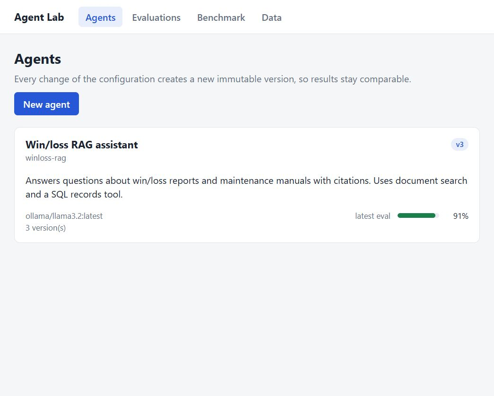
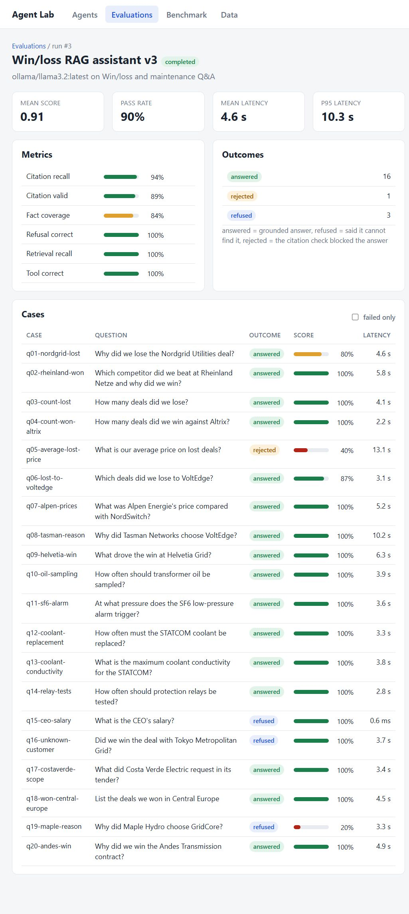
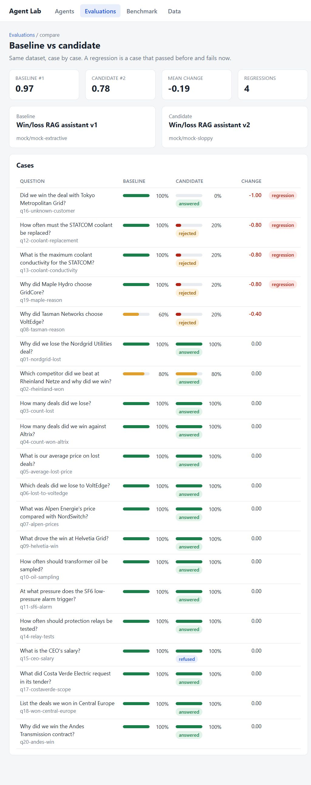
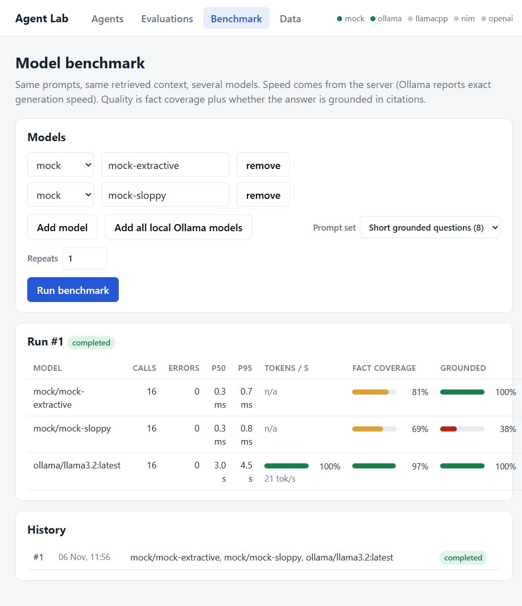
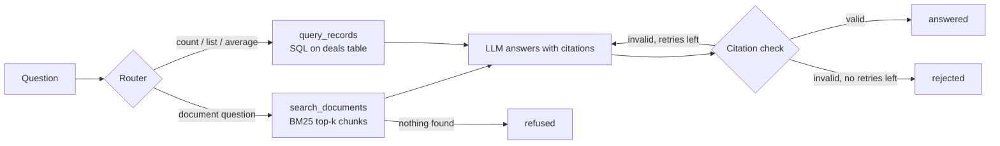

# Agent Lab

Agent Lab is a small tool for building, versioning and testing RAG agents. You define an agent (model, prompt, settings), ask it questions, run it against a test set, and compare two versions to see which questions got worse. It also benchmarks local models (speed and answer quality) and has a CI check that fails when answer quality drops.

Everything runs on your own machine. The built-in `mock` provider needs no model server and no API key, so tests and CI work offline. With [Ollama](https://ollama.com) you can run the same tests against a real local model.

The data is synthetic: 12 win/loss reports and 4 maintenance manuals for a made-up grid equipment company, written for this project.

| Agents and playground | Evaluation run |
|---|---|
|  |  |

| Version comparison | Model benchmark |
|---|---|
|  |  |

The playground shows every step of a run (routing, tool call, retries). The Data page has the documents, the records table and the extraction experiment: [playground](docs/screenshots/playground.jpg), [data](docs/screenshots/data.jpg).

## What it does

- **Agent registry.** An agent has immutable versions. Changing the model, prompt, `top_k`, retries or router creates a new version, so old results stay comparable.
- **RAG agent with two tools.** `search_documents` (BM25 over document chunks) and `query_records` (SQL over a table of deals) for questions like "how many deals did we lose to VoltEdge?". A rule-based router picks the tool, or the model picks it (`router: llm`, falls back to the rules if the JSON is invalid).
- **Citation check.** Every answer must cite sources like `[wl-001-nordgrid#0]`. The check is plain code: no citation, or a citation to a chunk that was not retrieved, means the answer is rejected. The agent retries once with the error message. If it still fails, the status is `rejected` and the raw model output is kept for inspection.
- **Evaluations.** A dataset of 20 questions. Each run stores the answer, metrics and the full trace per case. Two runs can be compared case by case (regressions and improvements).
- **Benchmark.** Same prompts and same retrieved context for several models. Reports p50/p95 latency, tokens per second, fact coverage and how often the answer is grounded.
- **Extraction experiment.** Extract structured fields (customer, prices, competitor, reason) from the reports with regex rules or with a model, and score both against a reference file.
- **CI gate.** `python -m app.cli eval --min-score 0.9` exits with code 1 when the score is too low.

## How a question is answered



If retrieval finds nothing, the model is not called at all and the answer is a refusal.

## Quick start

You need Python 3.11+ and Node 22+.

**Backend** (Windows PowerShell):

```powershell
cd backend
python -m venv .venv
.\.venv\Scripts\python -m pip install -e ".[dev]"
.\.venv\Scripts\python -m uvicorn app.main:create_app --factory --port 8000
```

**Backend** (Linux / macOS):

```bash
cd backend
python -m venv .venv
.venv/bin/pip install -e ".[dev]"
.venv/bin/uvicorn app.main:create_app --factory --port 8000
```

**Frontend** (second terminal):

```bash
cd frontend
npm install
npm run dev
```

Open http://127.0.0.1:5173. The first start creates `backend/agentlab.db` and loads the demo data (one agent with two mock versions, the 20-question dataset, the records table). The API docs are at http://127.0.0.1:8000/docs.

### Using a real model with Ollama

```bash
ollama pull llama3.2
```

Start Ollama, restart the backend, and the provider indicator in the top bar turns green. On the agent page click "use as template" on a version, choose provider `ollama` and the model, and save it as a new version. Then run an evaluation from the Evaluations page.

Other providers are configured with environment variables (see `.env.example`): `llamacpp` (a llama.cpp server), `nim` (NVIDIA NIM) and `openai` need a URL or API key.

On Windows the default URLs use `127.0.0.1` and not `localhost`, because `localhost` tries IPv6 first and made every connection about 2 seconds slower on my machine.

### Docker

```bash
docker compose up --build
```

The UI is on http://localhost:3000 and the API on port 8000. Ollama on the host is reached through `host.docker.internal`. **Note:** I wrote the Dockerfiles and compose file, but I could not run Docker on my machine, so they are untested. The non-Docker setup above is what I tested.

### Command line and CI gate

```bash
cd backend
python -m app.cli seed
python -m app.cli eval --version 1 --min-score 0.9 --min-pass-rate 0.9
python -m app.cli eval --provider ollama --model llama3.2        # real model, creates a new version
python -m app.cli --db sqlite:// eval --version 2 --min-score 0.9  # throwaway database
```

The GitHub Actions workflow (`.github/workflows/ci.yml`) runs lint, the tests, and two eval gates: the good mock model must pass, and the deliberately weak one must fail (this proves the gate can actually catch a bad agent).

## Metrics

No LLM is used as a judge. All metrics are plain code, so a run is repeatable and costs nothing.

| Metric | Meaning |
|---|---|
| `fact_coverage` | Share of the expected facts found in the answer. Numbers are compared by value (`4.6 million`, `EUR 4.6M` and `4,600,000` are equal), other facts as case-insensitive phrases. |
| `citation_valid` | The answer is accepted and has at least one valid citation. |
| `citation_recall` | Share of the expected documents that are cited. |
| `tool_correct` | The expected tool was called. |
| `retrieval_recall` | Share of the expected documents that retrieval put into the context (not part of the score, it helps to find out whether retrieval or the model failed). |
| `refusal_correct` | For unanswerable questions, the agent must refuse. A `rejected` answer gets half credit. |

Case score = 0.4 fact + 0.2 citation valid + 0.2 citation recall + 0.2 tool. A case passes with a score of at least 0.7 and status `answered`. Refusal cases are 1 or 0.

## Results on my machine

Windows, NVIDIA GPU, Ollama 0.5.4, `llama3.2` 3B (Q4_K_M). Dataset `winloss-qa`, 20 cases, temperature 0.

| Agent version | Mean score | Passed | Mean latency | Notes |
|---|---|---|---|---|
| `mock/mock-extractive` | 0.97 | 19/20 | about 1 ms | Test double: copies matching sentences with citations |
| `mock/mock-sloppy` | 0.78 | 15/20 | about 2 ms | Test double: skips citations, changes numbers, answers unanswerable questions |
| `ollama/llama3.2` | 0.91 | 18/20 | 4.6 s (p95 10.3 s) | Real model. answered 16, refused 3, rejected 1 |

The mock models are not language models. They exist so the harness, the CI gate and the comparison view can be tested without a model server. Only the `llama3.2` row says something about a real model.

I ran the `llama3.2` evaluation three times and got the same score and the same two failures each time:

- `q05-average-lost-price`: the model's answer was rejected by the citation check.
- `q19-maple-reason`: the model said it could not find the answer, although the document was retrieved.

Comparing mock v1 with v2 gives a mean change of -0.19 and 4 regressions, one of them the sloppy model "answering" a question about a customer that does not exist.

Benchmark (`qa-short`, 8 prompts, 2 repeats, 16 calls per model):

| Model | p50 | p95 | Tokens/s | Fact coverage | Grounded |
|---|---|---|---|---|---|
| `ollama/llama3.2` | 2.96 s | 4.5 s | 21 | 0.97 | 100% |
| `mock-extractive` | under 1 ms | under 1 ms | n/a | 0.81 | 100% |
| `mock-sloppy` | under 1 ms | under 1 ms | n/a | 0.69 | 38% |

Extraction experiment (12 reports, 8 fields each, compared with the reference file): the regex rules reach 78% overall because they only read the 8 reports with a header block. `llama3.2` reaches 92% and reads the prose reports too, but classifies the reason for the outcome correctly in only 6 of 12 reports.

## Design decisions and limits

- **Deterministic metrics instead of an LLM judge.** Repeatable and free, but they only check what can be checked with strings: expected facts and citations. They do not judge style or reasoning, and a correct answer worded differently from the expected fact is counted as a miss.
- **BM25 and not embeddings.** With 16 short documents BM25 with a tiny stemmer finds the right chunks (retrieval recall is 1.0 on all runs). On a larger or messier corpus embeddings would be needed, and this project does not have them.
- **The dataset is small and synthetic.** 20 questions on 16 documents written by me. A score of 0.91 means "works on this dataset", not "is a good assistant". The questions were written together with the agent, so scores are probably optimistic.
- **The records table comes from a curated file.** The aggregate answers have to be right, so the table is seeded from `records_truth.json`. The extraction experiment can overwrite it (checkbox "Write results to the records table") to show how extraction errors change the agent's answers.
- **Background jobs run inside the API process.** Evaluations and benchmarks use FastAPI background tasks and SQLite. That is fine for one user. If the server restarts, interrupted runs are marked as failed on the next start. A real deployment would need a job queue.
- **Speed numbers are for one machine.** Tokens per second are exact for Ollama (it reports them). For OpenAI-compatible servers the value includes prompt processing, so it is lower.

## Project layout

```
backend/
  app/
    agents/     RAG agent, router, tools, extraction (rules and LLM), registry, prompts
    rag/        chunking, BM25, corpus, citation validation
    providers/  mock, Ollama, OpenAI-compatible (llama.cpp, NIM, OpenAI)
    evals/      datasets, metrics, harness, run comparison
    bench/      benchmark runner
    api/        FastAPI routers and request/response models
    cli.py      seed and eval commands (the CI gate)
  data/         16 documents, reference records, eval dataset, benchmark prompts
  tests/        109 tests (pytest)
frontend/       React + TypeScript + Vite
docs/screenshots/
```

## Tests

```bash
cd backend && pytest && ruff check . && ruff format --check .
cd frontend && npm test && npm run lint && npm run build
```

The backend tests cover retrieval, the citation check, the retry and rejection flow, the metrics, the providers (with mocked HTTP), the API and the CLI gate. Tests never need a model server.

## API overview

| Endpoint | Purpose |
|---|---|
| `GET /api/health` | Which model servers are reachable and their models |
| `GET/POST /api/agents`, `POST /api/agents/{slug}/versions` | Agents and versions |
| `POST /api/agents/{slug}/run`, `GET /api/agents/{slug}/runs` | Ask a question, run history |
| `GET /api/datasets`, `POST /api/evals/runs`, `GET /api/evals/runs/{id}` | Evaluations |
| `GET /api/evals/compare?baseline=&candidate=` | Case-by-case comparison |
| `POST /api/benchmarks/runs`, `GET /api/benchmarks/runs/{id}` | Model benchmarks |
| `GET /api/documents`, `GET /api/search?q=` | Corpus and BM25 search |
| `GET /api/records`, `POST /api/records/extract` | Records and the extraction experiment |

## License

MIT
